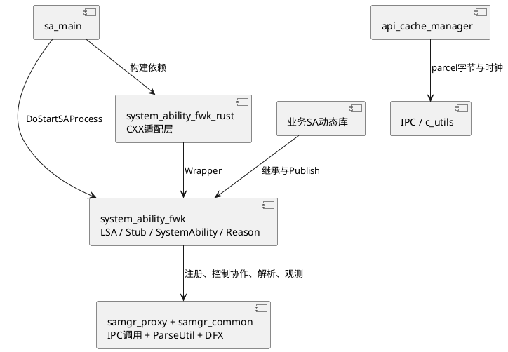

# 架构设计及约束

适用基线与验证边界见[业务背景](business-context.md)。本篇描述当前实现；AGENTS.md与README的简写若与当前路径/行为不同，保留原文件并在下面分别说明。

## 架构设计

### 设计原则

| 原则 | 描述 | 理由 |
|---|---|---|
| 全局管理与进程内执行分离 | samgr组织服务生命周期，LSA定位进程内SystemAbility并调用钩子 | 同一进程可承载多个SA，进程存在不能替代服务可用证据 |
| 本地构造与远端发布分离 | dlopen初始化触发本地AddAbility；业务准备好后Publish | 将对象初始化和可对外服务的时刻分开 |
| 配置决定承载方式 | Profile覆盖构造时runOnCreate、依赖等属性，Trust再过滤 | 业务源码中的默认值不能替代产品运行配置 |
| 生命周期与业务IPC分离 | LSA控制协议和业务IRemoteObject是不同对象 | 管理权限、业务权限及故障边界不能混为一层 |
| 初始化并行、阶段等待 | SaInit线程池承载同阶段任务；等待任务计数 | 提供阶段组织而不是全局依赖拓扑调度器 |
| 跨语言复用原生命周期 | Rust经SystemAbilityWrapper回到相同C++框架 | 语言桥影响所有权与转换，不重新定义samgr协议 |

### 逻辑架构

| 模块 | 路径 | 主要职责及协作 |
|---|---|---|
| 启动入口 | services/safwk/src/main.cpp、system_ability_start.cpp | 解析进程Profile与事件，转交LSA；两入口行为有差异 |
| 进程内组织 | services/safwk/src/local_ability_manager.cpp | Profile、对象/阶段表、原因、监听、unused定时器 |
| 控制协议 | services/safwk/src/local_ability_manager_stub.cpp | 权限、令牌、parcel解码、事务分发和fd收尾 |
| SA基类与模型 | services/safwk/src/system_ability.cpp、system_ability_ondemand_reason.cpp | 发布、生命周期、状态与事件数据 |
| SDK声明 | interfaces/innerkits/safwk、services/safwk/include | SDK头通过符号链接指向services中的声明；编译include与导出位置需一起核查 |
| 缓存 | services/safwk/src/api_cache_manager.cpp及SDK的expire_lru_cache.h | 按接口分桶、请求字节索引和TTL/LRU淘汰 |
| 语言桥 | interfaces/innerkits/safwk/rust | Rust trait、Handler、CXX桥、parcel转换 |
| 诊断/工具 | local_ability_manager_dumper.cpp、ffrt_handler.cpp、svc | 统计会话清理与限定服务控制 |
| 配置与验证 | etc/profile、etc/profile/subfoundation、test、README_zh.md | foundation/subfoundation部署、权限与数据目录配置，单测/模糊入口和开发示例 |



### 运行、线程与资源

- 主入口完成运行Profile初始化、等待samgr、注册LSA、初始化线程池、登记按需信息并执行阶段任务；之后开启unused查询并JoinWorkThread。[services/safwk/src/local_ability_manager.cpp：LocalAbilityManager::DoStartSAProcess](../../services/safwk/src/local_ability_manager.cpp#L116)。
- 初始化线程池线程数取hardware_concurrency，MAX_TASK_NUMBER=20传给SetMaxTaskNum；不能把20说成固定并发线程数。同阶段任务计数在startPhaseLock_下变更，以条件变量等待，等待上限100秒。[services/safwk/src/local_ability_manager.cpp：LocalAbilityManager::Run](../../services/safwk/src/local_ability_manager.cpp#L864)、[services/safwk/src/local_ability_manager.cpp：LocalAbilityManager::WaitForTasks](../../services/safwk/src/local_ability_manager.cpp#L798)。
- 当前StartAbility/StopAbility各创建detach的std::thread；Idle/Active/策略/扩展在调用线程同步执行。FFRTHandler主要服务统计会话的延时清理。本仓AGENTS要求避免新增std::thread，不代表当前实现已全部FFRT化。
- localAbilityMapLock_保护本地表；GetAbility返回裸指针并在返回前解锁，锁的作用不能扩展成对象使用期间的所有权保证。listenerLock_和ReasonLock_分别保护监听和原因表。
- SystemAbility使用递归abilityLock保护部分状态，onStartLock_串行化Start；Idle/Active/Stop检查状态后会在无该锁的区域调用业务钩子，再更新状态。不能推断所有生命周期操作全程互斥。

### 构建、产物与部署

| 目标 | 内容/条件 | 定位 |
|---|---|---|
| services/safwk:sa_main | 可执行入口，安装启用 | services/safwk/BUILD.gn |
| interfaces/innerkits/safwk:system_ability_fwk | 生命周期共享库，platformsdk安装子目录，platformsdk_indirect/sasdk | interfaces/innerkits/safwk/BUILD.gn |
| :system_ability_ondemand_reason | 原因模型静态库，samgr可消费 | 同上 |
| :api_cache_manager | 独立共享库，Proxy显式接入 | 同上 |
| interfaces/innerkits/safwk/rust:system_ability_fwk_rust | CXX生成+手写C++包装+Rust共享库 | Rust BUILD.gn |
| services/safwk:sa_start_group | safwk_feature_support_saspawn启用时引入sa_start | services/safwk/BUILD.gn |
| etc/profile/subfoundation:subfoundation_cfg、subfoundation_trust | 独立安装subfoundation启动、权限与Trust；包含通知/卡片等部署和数据目录归属 | etc/profile/subfoundation/BUILD.gn |
| svc:svc | 受限命令工具 | svc/BUILD.gn |
| etc/profile:foundation_cfg、foundation_trust | cfg受support_jsapi控制；Trust单独安装到profile | etc/profile/BUILD.gn |

依据：[services/safwk/BUILD.gn](../../services/safwk/BUILD.gn#L1)、[interfaces/innerkits/safwk/BUILD.gn](../../interfaces/innerkits/safwk/BUILD.gn#L1)、[interfaces/innerkits/safwk/rust/BUILD.gn](../../interfaces/innerkits/safwk/rust/BUILD.gn#L1)、[etc/profile/BUILD.gn](../../etc/profile/BUILD.gn#L1)。

config.gni默认关闭safwk_enable_run_on_demand_qos、safwk_feature_support_saspawn。前者使按需初次LoadSaLib前后尝试调整线程nice值；不是所有SA回调统一QoS。var.gni声明safwk_support_access_token，但当前生产Stub的CheckPermission及accesstoken依赖没有按该变量包围；该变量在测试/模糊构建可见，不能直接当成生产权限开关。[config.gni](../../config.gni#L1)、[var.gni](../../var.gni#L1)。

### 非功能设计

| 场景类别 | 方案设计 |
|---|---|
| 启动可靠性 | 路径realpath、samgr代理50次200ms等待、库注册等待10次100ms、依赖50ms轮询；不同等待量不可混算成统一超时 |
| 生命周期观测 | OnStart/OnStop耗时调用samgr提供的DFX适配器，关键操作有HiTrace和XCollie；未覆盖的早退不能声称都有ReportSaMainExit |
| IPC输入安全 | 先LSA令牌与事务权限，再said/parcel/fd检查；扩展和svc有各自权限 |
| 执行隔离 | 阶段任务池、按需线程、IPC线程、定时器回调具有不同阻塞影响 |
| 缓存性能 | 每API默认8项、单调时钟过期和LRU；失败回源由调用者组织，不自动判断成功回复 |
| 资源管理 | publishObj_保留对象、原因parcel显式释放、统计fd每个出口关闭、Rust Box转移与回收 |

### 验证入口

从源码树根可按实际产品运行下列命令；这里未执行，不能作为通过证据：

```bash
./build.sh --product-name {product} --build-target safwk
./build.sh --product-name {product} --build-target foundation/systemabilitymgr/safwk/test:unittest
./build.sh --product-name {product} --build-target foundation/systemabilitymgr/safwk/test/fuzztest/systemabilityfwk_fuzzer:fuzztest
```

[test/services/safwk/unittest/BUILD.gn](../../test/services/safwk/unittest/BUILD.gn#L1)包含LocalAbilityManagerTest、MockLocalAbilityManagerTest、SystemAbilityTest、CacheManagerTest、ExpireLruCacheTest、SaProxyCacheTest、SystemAbilityStartTest；另见[test/svc/unittest/BUILD.gn](../../test/svc/unittest/BUILD.gn#L1)和[interfaces/innerkits/safwk/rust/tests/BUILD.gn](../../interfaces/innerkits/safwk/rust/tests/BUILD.gn#L1)。已有断言与建议回归点在[机制知识](safwk-Technology.md)分别说明。

## 架构约束

- **契约归属**
  - **what**：LSA反向协议声明及码在相邻samgr，实现在本仓Stub；Profile解析依赖samgr_common。不能只改一侧协议或在知识文档中把外部保证写成本仓已验证事实。
  - **why**：编码顺序/动作或字段不一致会破坏跨进程分发，局部编译通过无法证明双方兼容。
- **状态与完成分层**
  - **what**：local map、isRunning_、abilityState_、samgr注册记录和进程状态分开观察。
  - **why**：Start回调返回、IPC发送成功、服务发布成功和卸载完成有不同证据。
- **配置与动态库初始化**
  - **what**：先有Profile再dlopen触发注册；源JSON经构建合成为运行Profile，运行时Trust按实际可读取文件处理。
  - **why**：AddAbility取不到Profile直接false；跨文件said/进程名错误会造成对象或远端注册缺失。
- **框架与业务线程边界**
  - **what**：回调不可无界阻塞；新增线程遵守AGENTS约束，既有detach路径需明确对象与参数生存期。
  - **why**：阶段等待和IPC线程耗尽会放大成多个服务的启动问题。
- **资料与实现差异**
  - **what**：AGENTS的dependTimeout“截断”与实际越界保留原值不同；“所有启动使用FFRT”和简单状态箭头也不能替代当前代码；本轮只补路由，保留原规则。
  - **why**：按简写设计验收会得到错误预期。修改业务实现或规则需独立明确需求。

### 最新部署与资源边界

[etc/profile/subfoundation/BUILD.gn：ohos_prebuilt_etc("subfoundation_cfg")](../../etc/profile/subfoundation/BUILD.gn#L23)声明subfoundation配置安装；[etc/profile/subfoundation/subfoundation.cfg："services"](../../etc/profile/subfoundation/subfoundation.cfg#L15)指定独立uid、sa_main与subfoundation运行Profile，以及通知数据目录的创建和属主迁移。Trust范围见`etc/profile/subfoundation/subfoundation_trust.json`。这些配置是产品部署输入；本文不修改权限、目录或Trust内容。

[services/safwk/src/local_ability_manager.cpp：LocalAbilityManager::OnStopAbility](../../services/safwk/src/local_ability_manager.cpp#L471)在Stop后按independentUnload分支移除本地对象索引、等引用释放、调用CloseSo并重登记按需信息。该分支可在同进程保留其他SA，不能将所有卸载简写为进程退出。

[services/safwk/src/local_ability_manager_stub.cpp：FDSAN_TAG_IPC_STAT](../../services/safwk/src/local_ability_manager_stub.cpp#L43)定义IPC统计、FFRT统计、svc三个fd owner tag；三个Inner接收后交换tag，早退和正常结束均以对应tag关闭。新增fd路径需保持原所有权配对。
