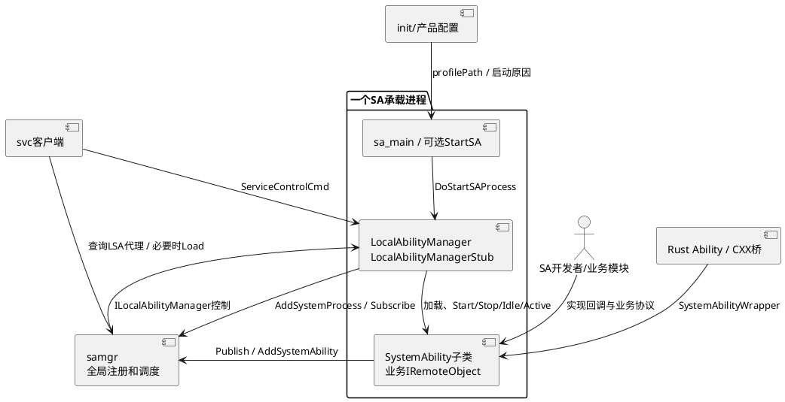

# 业务背景

本组知识依据源码提交 `2537eeed02eb4686824d394bccd1315d5c787b72`，适用于本仓当前工作区的标准系统实现。目录路径以safwk仓根为准；外部samgr路径显式写为相邻仓，不将其实现复制成本仓职责。文档来自静态阅读，未执行产品编译、单元测试或设备验证。

## 应用定位

### 核心职责

safwk把一个SA的业务实现接入系统服务管理体系：在目标进程中加载SA库、建立本地对象、安排启动和依赖等待、执行生命周期回调，并把业务远端对象发布到samgr。其主要产物是启动入口sa_main和供各SA进程链接的system_ability_fwk，不能把safwk等同一个独立的全局服务进程。组件信息见[bundle.json](../../bundle.json#L1)。

全局said映射、跨设备发现以及加载/卸载调度由samgr组织，safwk在每个承载进程内通过LocalAbilityManager接受控制。开发者实现SystemAbility的回调和业务Stub；safwk提供组织方式，不代替业务服务实现业务协议。[services/safwk/src/local_ability_manager.cpp：LocalAbilityManager::Run](../../services/safwk/src/local_ability_manager.cpp#L864)、[services/safwk/src/system_ability.cpp：SystemAbility::Publish](../../services/safwk/src/system_ability.cpp#L77)。

| 业务能力 | 本仓负责的行为 | 对AI开发与定界的价值 |
|---|---|---|
| 进程启动 | 参数解析、Profile与Trust处理、库初始化、注册LSA、分阶段启动 | 区分“进程未起”“对象未注册”“SA未发布” |
| 生命周期 | Start/Stop异步任务与Idle/Active回调、局部状态、启动失败通知 | 定义需求中的成功时刻和失败后状态 |
| 依赖与监听 | 启动前探测依赖；把samgr状态通知分发给本地监听SA | 区分强启动前提与持续监听，不混用 |
| 按需上下文 | 保存启动/停止原因，按需取得公共事件附加数据 | 将事件参数与SA行为建立可追踪关系 |
| 长时间未使用处理 | 读取已发布Stub最后请求时间，满足条件后向samgr请求卸载 | 区分主动卸载建议与真正完成停止 |
| 附加设施 | API响应缓存、Rust绑定、svc命令、IPC/FFRT诊断 | 覆盖跨语言与性能需求带来的约束 |

### 职责边界（本组件不负责）

- init负责按产品服务配置拉起进程、配置身份与权限；本仓提供foundation/subfoundation配置，包含权限、受信集合和部分数据目录迁移，不定义所有SA进程的启动策略。
- samgr负责全局服务注册表、按需状态调度、对象死亡清理和跨设备服务组织；本仓的ACTIVE/IDLE/NOT_LOADED不是samgr完整调度状态机。
- Profile结构与通用解析器ParseUtil由相邻samgr仓提供。构建时单SA源JSON可合成为按进程组织的运行Profile；不能把源文件“一个SA节点”规则当作运行时Profile必须单SA。
- StartSA是可选导出入口；本仓未实现父进程fork调度，不能把“启用saspawn产物”直接等同运行时一定走该路径。
- 缓存只按请求字节复用回复，不判断业务幂等性、调用者权限与数据一致性；是否可以缓存以及何时失效由使用方明确。

## 系统上下文

## 核心输入

| 来源 | 输入 | 前提与处理边界 |
|---|---|---|
| init或启动器 | argv中的Profile路径、`-m`配置和按需事件串 | main限制argc为2～64；按需串最多2000字符，分隔循环需得到5段，具体尾分隔行为见ParseArgv |
| 运行Profile | process、said、libpath、runOnCreate、bootPhase、dependSa/timeout及unusedTimeout | ParseUtil解析后，先按Trust过滤，再决定加载哪些库 |
| 动态库初始化 | REGISTER_SYSTEM_ABILITY_BY_ID或Rust register | 仅登记LocalAbilityManager；需要Profile已存在，said不能重复 |
| samgr的LSA事务 | said、原因JSON、策略、扩展、统计命令 | 先接口令牌与AccessToken权限，再按事务码分发 |
| samgr的状态回调 | said、deviceId、添加/移除事件 | 本地监听表去重后调用业务SA的通知钩子 |
| 业务Proxy | cache API键、请求和reply parcel | 只有主动接入PreSendRequest/PostSendRequest才使用缓存 |
| 管理工具 | svc类型与转发参数、输出fd | svc只识别wifi/bluetooth/nearlink/help顶层，不承诺本地校验所有子命令 |

依据：[services/safwk/src/main.cpp：ParseArgv](../../services/safwk/src/main.cpp#L108)、[services/safwk/src/local_ability_manager.cpp：LocalAbilityManager::AddAbility](../../services/safwk/src/local_ability_manager.cpp#L261)、[services/safwk/src/local_ability_manager_stub.cpp：LocalAbilityManagerStub::OnRemoteRequest](../../services/safwk/src/local_ability_manager_stub.cpp#L89)、[svc/src/svc_control.cpp：SvcControl::Main](../../svc/src/svc_control.cpp#L55)。

## 核心输出

| 输出 | 接收方 | 成功的实际含义 |
|---|---|---|
| AddSystemProcess注册LSA对象 | samgr | 承载进程可被控制，尚不代表每个SA已发布 |
| AddOnDemandSystemAbilityInfo | samgr | 告知可按需加载的said/进程关系，不等于已加载 |
| OnStart/OnStop及原因、Idle/Active | 业务SA | 生命周期钩子执行；Start返回与Publish成功需分别观察 |
| AddSystemAbility与SAExtraProp | samgr及消费者 | Publish仅在Add返回ERR_OK后置ACTIVE |
| RemoveSystemAbility/OnStartSystemAbilityFail | samgr | 请求移除或上报失败；本地状态与远端结果可能不一致 |
| OnAdd/OnRemove通知 | 监听SA | 受本地INIT/NOTIFIED去重；不是任意业务事件总线 |
| 卸载请求、DFX与命令文本 | samgr、诊断服务、fd | 卸载需后续完成证据；统计采集有自身会话状态 |

读法：[架构](architecture.md)定位模块，[实体](safwk-Entity.md)定位状态与关系，[机制](safwk-Technology.md)跟随完整流程；修改前再读[编码约束](coding-standards.md)，概念不清先查[术语](glossary.md)。
