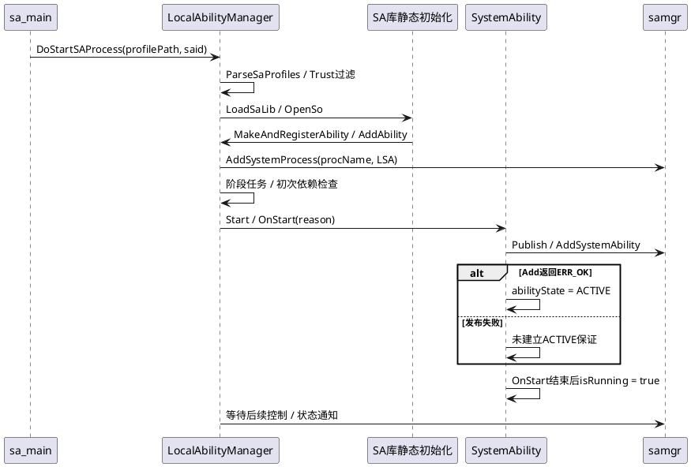
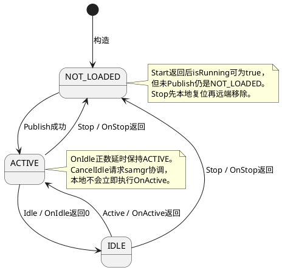

# 技术术语知识

safwk核心机制按问题、原理、用法与约束展开。每节的验收/定界建议来自当前源码推导，不是已运行测试或历史事故；已读测试断言会单独指出。实体语义见[业务实体](safwk-Entity.md)。

## 启动参数、Profile与进程初始化

### 解决的问题（Problem）

| 子维度 | 内容 |
|---|---|
| 业务痛点 | SA进程存活却不可查询时，仅查看OnStart会漏掉参数、运行配置、LSA登记等前置环节。 |
| 技术目标 | 把init输入到服务可用的链拆成可验证阶段，并保留早退原因。 |

### 原理（Principles）

| 子维度 | 内容 |
|---|---|
| 核心机制 | main检查argc/argv、扫描-m并调整事件参数下标；按需参数由#循环分段得到5项，said用StrToInt，事件ID/extraDataId使用atoi。Profile路径做.json子串检查，LSA再realpath规范化、解析Profile、等samgr、Run与JoinWorkThread。进程名显示由文件名推导，注册进程名取Profile.process，两者来源不同。 |
| 关键流程 | main→InitMallopt/ParseArgv/SetProcName→DoStartSAProcess→CheckAndGetProfilePath→InitSystemAbilityProfiles→CheckSystemAbilityManagerReady→Run→StartTimedQuery→JoinWorkThread。 |

### 使用方式（Usage）

| 子维度 | 内容 |
|---|---|
| 核心 API | 新增启动参数需同时核对-m偏移、数量/长度限制、两个启动入口；验收空路径、非法said、缺分隔符/尾分隔、samgr未就绪。定位按启动日志、Profile解析、AddSystemProcess、Publish逐层取证。 |

### 代码关联（Code）

| 子维度 | 内容 |
|---|---|
| 核心类 | [services/safwk/src/main.cpp：main(](../../services/safwk/src/main.cpp#L216)；[services/safwk/src/local_ability_manager.cpp：LocalAbilityManager::DoStartSAProcess](../../services/safwk/src/local_ability_manager.cpp#L116) |
| 核心成员 | DEFAULT_JSON、ARGC_LIMIT/MAX_COUNT、eventIndex、procName_、profileParser_、startBegin_。 |
| 核心方法 | ParseArgv最多2000字符；CheckSystemAbilityManagerReady最多50次200ms重取代理；Run负责控制对象登记，不能将main返回0作为业务成功。 |

### 约束与限制（Constraints）

| 子维度 | 内容 |
|---|---|
| 系统限制 | 大量错误以返回0结束，只有部分分支ReportSaMainExit；不能只用进程退出码或单条事件推断启动完成。 |
| 并发约束 | sa_main主线程进入IPC前需完成初始化；不要在静态构造/OnStart里递归等待自身发布。 |
| 安全约束 | realpath存在性/长度检查不是所有Profile路径的统一目录白名单保证；进程身份与产品权限由init配置。 |

## Profile与Trust过滤及加载策略

### 解决的问题（Problem）

| 子维度 | 内容 |
|---|---|
| 业务痛点 | 开发源配置与运行合并配置、构造参数和最终属性常被混用，导致错误的加载预期。 |
| 技术目标 | 明确配置源真值与过滤条件，区分未配置、被过滤和加载失败。 |

### 原理（Principles）

| 子维度 | 内容 |
|---|---|
| 核心机制 | LSA从samgr的ParseUtil取进程名及Profile列表；若/system/profile/<process>_trust.json存在则尝试解析。只有解析成功且trustMaps非空才逐个删除不允许said；有效map缺本process会得到空允许集合并删除本进程配置。然后按初始指定said或BOOT_START加载。 |
| 关键流程 | ParseSaProfiles→CheckPathExist→CheckTrustSa/RemoveSaProfile→InitializeSaProfiles→LoadSaLib或OpenSo→InitializeSaProfilesInnerLocked。 |

### 使用方式（Usage）

| 子维度 | 内容 |
|---|---|
| 核心 API | 新增SA四件套需对齐said、库、源JSON与进程配置；验收Trust允许/不允许、文件缺失/损坏、map为空及process不匹配。已有LocalAbilityManagerTest.CheckTrustSa001断言过滤后profiles.size()==2；这是已读测试内容，本轮未执行。 |

### 代码关联（Code）

| 子维度 | 内容 |
|---|---|
| 核心类 | [services/safwk/src/local_ability_manager.cpp：LocalAbilityManager::CheckTrustSa](../../services/safwk/src/local_ability_manager.cpp#L237)；[test/services/safwk/unittest/local_ability_manager_test.cpp：CheckTrustSa001](../../test/services/safwk/unittest/local_ability_manager_test.cpp#L161) |
| 核心成员 | profileParser_、procName_、trustMaps与其进程→said集合。 |
| 核心方法 | InitSystemAbilityProfiles/InitializeSaProfiles选择路径；AddAbility从剩余Profile取属性；Readme源JSON单节点规则属于构建输入约定。 |

### 约束与限制（Constraints）

| 子维度 | 内容 |
|---|---|
| 系统限制 | Trust缺失或解析失败不等同拒绝所有SA；不可把它描述成无条件的安全门。要改变失败策略需明确独立需求。 |
| 并发约束 | 初始化可能触发库构造回调AddAbility；禁止在持本地表锁的错误层再触发不可控注册。 |
| 安全约束 | Profile、Trust和运行进程权限各自验证；仅有Trust条目不授予管理/业务IPC权限。 |

## 动态库注册与业务发布两阶段

### 解决的问题（Problem）

| 子维度 | 内容 |
|---|---|
| 业务痛点 | 本地map有SA、OnStart执行过，但客户端查询为空，常因把注册宏当成远端发布。 |
| 技术目标 | 将库装载、对象构造、回调执行和可对外服务的证据逐项对齐。 |

### 原理（Principles）

| 子维度 | 内容 |
|---|---|
| 核心机制 | REGISTER_SYSTEM_ABILITY_BY_ID实际new并调用MakeAndRegisterAbility→LSA.AddAbility。后者先查询Profile、拒绝重复said并注入属性；只写localAbilityMap_。框架Start触发业务初始化，由业务在就绪后Publish远端对象；Publish保存publishObj_、构造SAExtraProp并向samgr AddSystemAbility。 |
| 关键流程 | LoadSaLib/OpenSo→库静态初始化→宏/Rust register→AddAbility→Start/OnStart→Publish→samgr.AddSystemAbility→本地ACTIVE。 |

### 使用方式（Usage）

| 子维度 | 内容 |
|---|---|
| 核心 API | 新服务可从listen_ability示例理解类、Stub、Profile与构建配套；不能在业务构造中提前GetSystemAbility。验收缺Profile、重复said、Publish空对象、samgr代理空、Add失败以及成功后的查询和后续回调。 |

### 代码关联（Code）

| 子维度 | 内容 |
|---|---|
| 核心类 | [interfaces/innerkits/safwk/system_ability.h：REGISTER_SYSTEM_ABILITY_BY_ID](../../interfaces/innerkits/safwk/system_ability.h#L29)；[services/safwk/src/system_ability.cpp：SystemAbility::Publish](../../services/safwk/src/system_ability.cpp#L77)；[test/services/safwk/unittest/listen_ability/src/listen_ability.cpp](../../test/services/safwk/unittest/listen_ability/src/listen_ability.cpp#L1) |
| 核心成员 | localAbilityMap_、publishObj_、abilityState_、capability_、permission_、Profile属性。 |
| 核心方法 | MakeAndRegisterAbility登记本地；Publish是远端发布；OnStartFail只发启动失败通知，不自动撤销本地对象或isRunning_。 |

### 约束与限制（Constraints）

| 子维度 | 内容 |
|---|---|
| 系统限制 | Start结束仍置isRunning_=true，即便OnStart没有成功Publish；失败Publish也可能保留publishObj_。 |
| 并发约束 | AddAbility在赋属性/写map期间持unique_lock；Publish的状态变化在abilityLock下，但先保存发布引用的时序需独立审查。 |
| 安全约束 | 注册宏内部new是框架约定，AGENTS“禁止手动new”针对绕过注册流程；Rust等现有入口是明确适配，不应机械删改。 |

## 首次启动阶段、依赖轮询与等待边界

### 解决的问题（Problem）

| 子维度 | 内容 |
|---|---|
| 业务痛点 | 某SA初始化慢可能阻碍阶段推进；配置依赖无法满足时需区分等待、跳过Start和业务自身阻塞。 |
| 技术目标 | 用阶段任务、依赖检查与发布完成三层时序设计需求，避免把任务计数当可用性。 |

### 原理（Principles）

| 子维度 | 内容 |
|---|---|
| 核心机制 | 普通启动按BOOT_START→CORE_START→OTHER_START。当前StartPhaseTasks投递本阶段后会加载下一阶段库，然后WaitForTasks；同阶段并行。每任务有65秒XCollie包装，依赖50ms间隔轮询，超时后最终缺依赖则不Start，但仍完成该任务计数。WaitForTasks上限100秒后清零，Run随后Stop线程池，其整体耗时不能简单由100秒推出。 |
| 关键流程 | InitializeRunOnCreateSaProfiles(1)→FindAndStartPhaseTasks→AddTask→StartDependSaTask/Start→计数归零或等待超时→后续阶段。 |

### 使用方式（Usage）

| 子维度 | 内容 |
|---|---|
| 核心 API | 新增跨SA依赖先检查阶段方向与发布时刻，环依赖/后阶段依赖可能耗尽等待。回归边界200/60000ms、非法依赖ID、同阶段延迟发布和依赖消失；GetSystemAbility存在不等于业务健康。 |

### 代码关联（Code）

| 子维度 | 内容 |
|---|---|
| 核心类 | [services/safwk/src/local_ability_manager.cpp：LocalAbilityManager::StartDependSaTask](../../services/safwk/src/local_ability_manager.cpp#L694)；[services/safwk/src/local_ability_manager.cpp：LocalAbilityManager::WaitForTasks](../../services/safwk/src/local_ability_manager.cpp#L798)；[services/safwk/src/system_ability.cpp：SystemAbility::SetDependTimeout](../../services/safwk/src/system_ability.cpp#L371) |
| 核心成员 | abilityPhaseMap_、initPool_、startTaskNum_、startPhaseCV_、dependSa_/dependTimeout_。 |
| 核心方法 | CheckDependencyStatus只对有效said调用CheckSystemAbility；SetDependTimeout合法才赋值，非法保留原值。 |

### 约束与限制（Constraints）

| 子维度 | 内容 |
|---|---|
| 系统限制 | 初始化路径拥有该等待机制；后续进程内按需Start走StartOndemandSystemAbility直接Start，不保证同样等待依赖。 |
| 并发约束 | 线程池任务并发且阶段计数独立于远端注册；Start/Publish可同步调用samgr。 |
| 安全约束 | 依赖列表来自运行配置，应验证said与业务关系，不能依赖非法ID被跳过来表达可选依赖。 |

## 进程内按需启停与异步结果

### 解决的问题（Problem）

| 子维度 | 内容 |
|---|---|
| 业务痛点 | 控制请求返回成功后SA仍未出现/消失，不能只在调用端按bool定位。 |
| 技术目标 | 明确线程受理、库对象可得、回调执行与samgr记录变化各自的观察点。 |

### 原理（Principles）

| 子维度 | 内容 |
|---|---|
| 核心机制 | StartAbility解析JSON并覆盖said原因，创建detach线程；任务LoadSaLib后最多10次100ms等localAbilityMap_出现，再直接OnStartAbility。StopAbility同样保存原因并异步调用Stop。Stub只返回协议status，Start/Stop不写reply业务bool；控制端异步发送语义需查samgr Proxy。 |
| 关键流程 | LSA.StartAbility→SetStartReason→线程→LoadSaLib→等待本地注册→SystemAbility.Start→Publish；Stop对应Stop→OnStop→本地复位→RemoveSystemAbility。 |

### 使用方式（Usage）

| 子维度 | 内容 |
|---|---|
| 核心 API | SDD把“启动已受理”“SA可查询”“停止记录已移除”写成不同验收条件。故障检查按控制端发送、Stub权限/解码、线程进入、dlopen、宏登记、回调、Publish日志串联；不能因bool=true断言成功。 |

### 代码关联（Code）

| 子维度 | 内容 |
|---|---|
| 核心类 | [services/safwk/src/local_ability_manager.cpp：LocalAbilityManager::StartAbility](../../services/safwk/src/local_ability_manager.cpp#L551)；[services/safwk/src/local_ability_manager.cpp：LocalAbilityManager::StopAbility](../../services/safwk/src/local_ability_manager.cpp#L570)；[services/safwk/src/local_ability_manager_stub.cpp：LocalAbilityManagerStub::StartAbilityInner](../../services/safwk/src/local_ability_manager_stub.cpp#L113) |
| 核心成员 | saIdToStartReason_/saIdToStopReason_、localAbilityMap_、线程捕获this和said。 |
| 核心方法 | StartOndemandSystemAbility等待对象；OnStartAbility只检查对象并调用void Start，故true不代表Start状态守卫通过。 |

### 约束与限制（Constraints）

| 子维度 | 内容 |
|---|---|
| 系统限制 | LoadSaLib/等待失败只日志返回，未自动补完所有失败通知；同said并发请求可能共享最后写入的原因。 |
| 并发约束 | detach无法靠调用栈保证this/SA对象寿命；Start串行化不涵盖所有Idle/Stop竞争。 |
| 安全约束 | Start/Stop前的LSA权限必须保留；不得因已定位本地对象而绕过管理授权。 |

## 本地生命周期、空闲与取消卸载

### 解决的问题（Problem）

| 子维度 | 内容 |
|---|---|
| 业务痛点 | ACTIVE、isRunning_、OnIdle延时和CancelIdle返回容易被解释为同一状态。 |
| 技术目标 | 在状态守卫、回调返回和远端协调之间建立准确契约。 |

### 原理（Principles）

| 子维度 | 内容 |
|---|---|
| 核心机制 | Start仅NOT_LOADED执行，OnStart后isRunning=true，ACTIVE由Publish决定。Idle仅ACTIVE执行，错误状态delay=-1；OnIdle返回0才置IDLE，正数延后而本地保持ACTIVE。Active只从IDLE回调后置ACTIVE。CancelIdle在非IDLE直接true，在IDLE向samgr请求CancelUnload，不自行调用OnActive。Stop先执行OnStop，再复位本地状态，随后请求远端Remove。 |
| 关键流程 | ACTIVE→Idle检查→OnIdle(delay)→若0则IDLE→Active/OnActive→ACTIVE；非NOT_LOADED→Stop/OnStop→NOT_LOADED→远端移除。 |

### 使用方式（Usage）

| 子维度 | 内容 |
|---|---|
| 核心 API | 需求需分别定义拒绝Idle(-1)、延后(正数)、接受(0)和取消请求的成功含义。验证Active非法前态、重复Start、Publish失败后Stop、Remove失败后本地/全局分歧。静态StopAbility仅请求samgr Remove，与完整Stop钩子链不同。 |

### 代码关联（Code）

| 子维度 | 内容 |
|---|---|
| 核心类 | [services/safwk/src/system_ability.cpp：SystemAbility::Idle](../../services/safwk/src/system_ability.cpp#L212)；[services/safwk/src/system_ability.cpp：SystemAbility::CancelIdle](../../services/safwk/src/system_ability.cpp#L119)；[services/safwk/src/system_ability.cpp：SystemAbility::Stop()](../../services/safwk/src/system_ability.cpp#L260) |
| 核心成员 | abilityState_、isRunning_、publishObj_、onStartLock_、abilityLock。 |
| 核心方法 | Idle/Active/Stop的guard与更新；CancelIdle返回协调请求结果；StopAbility不直接调用OnStop。 |

### 约束与限制（Constraints）

| 子维度 | 内容 |
|---|---|
| 系统限制 | LSA.ActiveAbility/IdleAbility找到对象就可能返回true，业务方法内部状态guard仍可不转换；IDL/源码注释不能替代此语义。 |
| 并发约束 | 各回调不在完整统一锁内执行，若新增同步/异步状态修改必须分析重入与Stop并发。 |
| 安全约束 | OnStop应先收尾业务资源，远端移除失败不能通过本地NOT_LOADED被掩盖。 |

## 监听去重、通知与失败残留

### 解决的问题（Problem）

| 子维度 | 内容 |
|---|---|
| 业务痛点 | 添加监听返回失败、重复添加无通知或删除后仍有远端通知，需同时看两层状态。 |
| 技术目标 | 说明远端订阅复用、本地去重及错误后副作用，为重试和回归提供依据。 |

### 原理（Principles）

| 子维度 | 内容 |
|---|---|
| 核心机制 | 目标said下维护listenerSaId列表；首次建立远端订阅，后续复用。添加事件只通知INIT并设NOTIFIED，移除通知全部并复位。准备目标列表后解锁进入业务回调。远端Subscribe失败没有自动删除先写入的本地项，末项UnSubscribe失败时本地桶已删除。 |
| 关键流程 | AddSystemAbilityListener→写本地项→Subscribe→SystemAbilityListener→FindAndNotify→NotifyAbilityListener；Remove最后项→删桶→UnSubscribe。 |

### 使用方式（Usage）

| 子维度 | 内容 |
|---|---|
| 核心 API | 变更需定义远端失败后的补偿/重试策略，不能默认现有false无副作用。验证重复注册、远端已存在SA的新监听者、Subscribe失败重试、最后项解除失败、通知时监听SA已被移除。 |

### 代码关联（Code）

| 子维度 | 内容 |
|---|---|
| 核心类 | [services/safwk/src/local_ability_manager.cpp：LocalAbilityManager::AddSystemAbilityListener](../../services/safwk/src/local_ability_manager.cpp#L302)；[services/safwk/src/local_ability_manager.cpp：LocalAbilityManager::RemoveSystemAbilityListener](../../services/safwk/src/local_ability_manager.cpp#L353)；[services/safwk/src/local_ability_manager.cpp：LocalAbilityManager::FindAndNotifyAbilityListeners](../../services/safwk/src/local_ability_manager.cpp#L422) |
| 核心成员 | localListenerMap_、ListenerState、listenerLock_、statusChangeListener_。 |
| 核心方法 | GetSystemAbilityStatusChange懒建共享listener；NotifyAbilityListener按listenerSaId找本地对象。 |

### 约束与限制（Constraints）

| 子维度 | 内容 |
|---|---|
| 系统限制 | 通知去重不承诺业务回调执行成功；标记更新在回调前，目标对象丢失时不能自动推断后续重发。 |
| 并发约束 | 不要在listenerLock_下新增跨模块业务回调；业务回调可再次添加/删除监听。 |
| 安全约束 | 目标ID与监听ID均验证范围；远端订阅和业务查询仍有samgr授权边界。 |

## 原因传递、公共事件取数与线格式

### 解决的问题（Problem）

| 子维度 | 内容 |
|---|---|
| 业务痛点 | 业务收到缺少原因字段或want为空时，可能是参数、缓存、序列化或语言转换失败。 |
| 技术目标 | 将原因ID与额外载荷的来源、有效期和降级行为串联。 |

### 原理（Principles）

| 子维度 | 内容 |
|---|---|
| 核心机制 | argv事件和LSA JSON格式不同，都会转为said原因；JsonToOnDemandReason检查字段类型。只有COMMON_EVENT才触发GetOnDemandReasonExtraData→samgr→parcel，读出成功复制后delete。额外want序列化成JSON字符串，只还原字符串值；失败只提前返回取数函数，生命周期回调继续。 |
| 关键流程 | 触发者→LSA原因表→Reason→HasExtraData→samgr extraDataId查询→ReadParcelable→SetExtraData→业务回调。 |

### 使用方式（Usage）

| 子维度 | 内容 |
|---|---|
| 核心 API | 验收COMMON_EVENT正常/ID失效、缺eventId、字段错误类型、空data、want含非字符串值和截断parcel。SDD应明确附加数据不可得时业务是否允许继续；当前框架不会自动拒绝回调。 |

### 代码关联（Code）

| 子维度 | 内容 |
|---|---|
| 核心类 | [services/safwk/src/system_ability_ondemand_reason.cpp：OnDemandReasonExtraData::Unmarshalling](../../services/safwk/src/system_ability_ondemand_reason.cpp#L61)；[services/safwk/src/system_ability.cpp：SystemAbility::GetOnDemandReasonExtraData](../../services/safwk/src/system_ability.cpp#L153)；[services/safwk/src/local_ability_manager.cpp：LocalAbilityManager::JsonToOnDemandReason](../../services/safwk/src/local_ability_manager.cpp#L607) |
| 核心成员 | ReasonLock_、原因JSON、reasonId_/extraDataId_、OnDemandReasonExtraData。 |
| 核心方法 | HasExtraData只看原因ID；Marshalling顺序code/data/wantJSON；Unmarshalling分配返回值。 |

### 约束与限制（Constraints）

| 子维度 | 内容 |
|---|---|
| 系统限制 | C++默认reasonId_未显式初始化，缺字段不能按INTERFACE_CALL解释；main用atoi转换extraDataId的宽度也不能当全64位无损输入。 |
| 并发约束 | 按said存一份原因会被后续请求覆盖；不要将该map当事件队列。 |
| 安全约束 | 跨语言解码白名单/默认返回不同，缺数据不能充当权限或来源校验结果。 |

## 管理IPC授权、扩展和fd生命周期

### 解决的问题（Problem）

| 子维度 | 内容 |
|---|---|
| 业务痛点 | 同样ERR_PERMISSION_DENIED或INVALID_DATA可能来自不同入口；扩展返回值也不同于业务请求完成。 |
| 技术目标 | 明确令牌、事务权限、解包、业务处理和资源释放的分层边界。 |

### 原理（Principles）

| 子维度 | 内容 |
|---|---|
| 核心机制 | LSA OnRemoteRequest先比对ohos.localabilitymanager.accessToken，再按code校验管理/扩展/svc权限，最后查分发表。扩展Inner取said/extension并借用data/reply指针；manager忽略isAsync参数，直接调用OnExtension。统计与svc读入fd，失败及正常处理后以对应FDSAN tag关闭接收fd。 |
| 关键流程 | token→VerifyAccessToken→memberFuncMap_→Inner验证→GetAbility→业务OnExtension/OnSvcCmd或统计→reply/status→close(fd)。 |

### 使用方式（Usage）

| 子维度 | 内容 |
|---|---|
| 核心 API | 新增事务需核对相邻samgr协议码、Proxy/Stub读写顺序、默认权限归类及输出。验收错token、权限拒绝、合法未知code、截断输入、非法said/fd、业务错误和每个fd出口。 |

### 代码关联（Code）

| 子维度 | 内容 |
|---|---|
| 核心类 | [services/safwk/src/local_ability_manager_stub.cpp：LocalAbilityManagerStub::CheckPermission](../../services/safwk/src/local_ability_manager_stub.cpp#L72)；[services/safwk/src/local_ability_manager_stub.cpp：LocalAbilityManagerStub::SystemAbilityExtProcInner](../../services/safwk/src/local_ability_manager_stub.cpp#L306)；[services/safwk/src/local_ability_manager_stub.cpp：LocalAbilityManagerStub::ServiceControlCmdInner](../../services/safwk/src/local_ability_manager_stub.cpp#L348) |
| 核心成员 | memberFuncMap_、LOCAL_ABILITY_MANAGER_INTERFACE_TOKEN、SystemAbilityExtensionPara.data_/reply_。 |
| 核心方法 | EnforceInterceToken、CheckPermission为入口门禁；各Inner控制协议；SystemAbilityExtProc转业务OnExtension。 |

### 约束与限制（Constraints）

| 子维度 | 内容 |
|---|---|
| 系统限制 | 业务接口令牌不等于LSA令牌；不能用业务Stub安全策略代替管理面授权。生产代码实际校验不应由var.gni名称推断可关闭。 |
| 并发约束 | 同步回调可能阻塞IPC线程；data/reply栈借用不能保存到后台任务，接收fd结束后也不能继续使用。 |
| 安全约束 | 权限分别为ohos.permission.ACCESS_EXT_SYSTEM_ABILITY、CONTROL_SVC_CMD、MANAGE_SYSTEM_ABILITY；必须与调用事务配套。 |

## 长期未使用检测与卸载建议

### 解决的问题（Problem）

| 子维度 | 内容 |
|---|---|
| 业务痛点 | 配置了unusedTimeout却没有卸载，或明明业务仍有工作却被提出卸载，需区分策略激活与访问时间。 |
| 技术目标 | 解释检测是否启用、阈值来源和卸载后续边界。 |

### 原理（Principles）

| 子维度 | 内容 |
|---|---|
| 核心机制 | StartTimedQuery先查当前本地对象白名单（当前为空），若IsResident=false才建立unused配置/定时器。只收集非runOnCreate且timeout!=-1的项，秒→毫秒后限1～120分钟，每分钟扫描。取发布IRemoteObject转IPCObjectStub的最后请求时间，idleTime严格大于阈值才发UnloadSystemAbility。 |
| 关键流程 | Run完成→StartTimedQuery→IsResident→InitUnusedCfg→Timer.Setup/Register→IdentifyUnusedOndemand→UnloadSystemAbility；析构StopTimedQuery注销并Shutdown。 |

### 使用方式（Usage）

| 子维度 | 内容 |
|---|---|
| 核心 API | 验收混合常驻/按需、无配置、上下限、无法取发布对象、等于阈值、卸载被samgr拒绝。定界先查检测是否启动，再查最后访问时间及业务是否通过框架假设的Stub发布，最后查samgr卸载链。 |

### 代码关联（Code）

| 子维度 | 内容 |
|---|---|
| 核心类 | [services/safwk/src/local_ability_manager.cpp：LocalAbilityManager::LimitUnusedTimeout](../../services/safwk/src/local_ability_manager.cpp#L1089)；[services/safwk/src/local_ability_manager.cpp：LocalAbilityManager::GetSaLastRequestTime](../../services/safwk/src/local_ability_manager.cpp#L1111)；[services/safwk/src/local_ability_manager.cpp：LocalAbilityManager::StopTimedQuery](../../services/safwk/src/local_ability_manager.cpp#L1194) |
| 核心成员 | unusedCfgMap_、idleTimer_、ondemandTimer_、publishObj_。 |
| 核心方法 | IsResident遍历当前localAbilityMap_；NoNeedCheckUnused为空白名单；IdentifyUnusedOndemand忽略卸载结果并保留策略。 |

### 约束与限制（Constraints）

| 子维度 | 内容 |
|---|---|
| 系统限制 | 只看IPC最后请求不代表所有业务活跃度；定时请求不是最终Stop；转换前timeout*1000的实际整数表达式也不能扩大描述为对任意整数无溢出保证。 |
| 并发约束 | Timer回调与生命周期并发；对象裸指针及publishObj_读取需按实际使用边界审查。 |
| 安全约束 | 卸载授权、状态守卫由samgr继续执行，不得绕过为直接回调Stop。 |

## API响应缓存与TTL/LRU

### 解决的问题（Problem）

| 子维度 | 内容 |
|---|---|
| 业务痛点 | 缓存可减少IPC，但如果键、失效和成功判断不完整，会复用错误、过期或其他上下文回复。 |
| 技术目标 | 界定当前设施提供的字节缓存能力，以及业务必须补充的选择与一致性规则。 |

### 原理（Principles）

| 子维度 | 内容 |
|---|---|
| 核心机制 | 接口桶键是descriptor+apiCode，请求key是完整parcel字节。Pre命中把缓存字节追加到reply，失败返回false供调用者回源。Post拒绝含对象offset的data/reply，然后缓存完整回复字节，不判断业务status。LRU容量默认8；TTL按毫秒写入时间计算，Get只更新LRU，不续期，满时优先清过期再淘汰尾部。 |
| 关键流程 | AddCacheApi→Pre→命中复用/未中真实SendRequest→由调用者筛选后Post→Clear或Del；重复Add不更新TTL。 |

### 使用方式（Usage）

| 子维度 | 内容 |
|---|---|
| 核心 API | 仅给有明确可缓存性、身份隔离和失效条件的API接入。验收相同/不同请求、错误reply、对象offset、服务死亡/状态变化、TTL=0/负数/边界、满桶与访问不续TTL。ConstructorTest001断言默认8/1000、容量0转1及负TTL转1000；Timestamp001按毫秒等待检查过期，均为静态已读未运行。 |

### 代码关联（Code）

| 子维度 | 内容 |
|---|---|
| 核心类 | [services/safwk/src/api_cache_manager.cpp：ApiCacheManager::PostSendRequest](../../services/safwk/src/api_cache_manager.cpp#L140)；[interfaces/innerkits/safwk/expire_lru_cache.h：DoGet](../../interfaces/innerkits/safwk/expire_lru_cache.h#L51)；[test/services/safwk/unittest/expire_lru_cache_test.cpp：Timestamp001](../../test/services/safwk/unittest/expire_lru_cache_test.cpp#L389) |
| 核心成员 | caches_、cachesMutex_、data_、timestamp_、keys_、expireTimeMilliSec_。 |
| 核心方法 | ClearCache只清项保留桶；DelCacheApi删除桶；IsExpired以diff>interval判断。 |

### 约束与限制（Constraints）

| 子维度 | 内容 |
|---|---|
| 系统限制 | expireTimeSec参数名与当前毫秒实现不一致；缓存不按远端对象/用户/token自动隔离；空reply缓冲的处理需单独验证，不因无offset就认定一定安全。 |
| 并发约束 | manager锁与LRU锁保护局部操作；Pre→IPC→Post不是一个事务，失效和回写可竞争。 |
| 安全约束 | 有权限敏感、身份相关、非幂等/副作用的API不能仅按请求字节相同就安全复用。 |

## Rust桥接、生命周期与所有权

### 解决的问题（Problem）

| 子维度 | 内容 |
|---|---|
| 业务痛点 | Rust服务可复用C++框架，但注册错误被丢弃、Handler裸指针和Box转移容易让AI误判安全边界。 |
| 技术目标 | 明确跨语言每个对象的持有方、错误映射与数据借用期限。 |

### 原理（Principles）

| 子维度 | 内容 |
|---|---|
| 核心机制 | Ability trait包装进Box，再BuildSystemAbility得UniquePtr；register(self)调用into_raw转交RegisterAbility且丢弃返回bool。Wrapper把Rust AbilityWrapper Box转raw，析构from_raw回收；publish为Rust RemoteStub再建立RemoteServiceStub，独立管理Box。Handler的Clone仅复制raw指针。 |
| 关键流程 | Rust初始化→build→register→C++ Start→OnStartWithReason→Rust trait/Handler.publish→C++ Publish→samgr；退出/析构回收各自Box。 |

### 使用方式（Usage）

| 子维度 | 内容 |
|---|---|
| 核心 API | 变更trait、wrapper.rs与手写C++同时核对。验证register失败、句柄延迟使用、发布失败、重复释放、OnExtension回传和dump fd生命周期。wrapper.rs内on_extension_ut对扩展转发/parcel内容有断言，本轮未运行。 |

### 代码关联（Code）

| 子维度 | 内容 |
|---|---|
| 核心类 | [interfaces/innerkits/safwk/rust/src/ability.rs：pub struct Handler](../../interfaces/innerkits/safwk/rust/src/ability.rs#L130)；[interfaces/innerkits/safwk/rust/src/exts.rs：pub fn register](../../interfaces/innerkits/safwk/rust/src/exts.rs#L47)；[interfaces/innerkits/safwk/rust/src/cxx/system_ability_wrapper.cpp：SystemAbilityWrapper::~SystemAbilityWrapper](../../interfaces/innerkits/safwk/rust/src/cxx/system_ability_wrapper.cpp#L35)；[interfaces/innerkits/safwk/rust/src/wrapper.rs：on_extension_ut](../../interfaces/innerkits/safwk/rust/src/wrapper.rs#L343) |
| 核心成员 | Box<dyn Ability>、UniquePtr<SystemAbilityWrapper>、Handler.inner、RemoteServiceStub.inner_、MsgParcel借用。 |
| 核心方法 | PublishWrapper/BuildReasonWrapper/SerializeOnDemandReasonExtraData与Rust Serialize/Deserialize负责转换。 |

### 约束与限制（Constraints）

| 子维度 | 内容 |
|---|---|
| 系统限制 | C++包含UNREF_EVENT=6，Rust枚举Deserialize只接受0～5；C++解析附加数据失败被Rust桥转空默认值，外层Deserialize可能仍Ok；Rust注释的正延时表述需结合C++Idle实际只在0进入IDLE。 |
| 并发约束 | trait &self与Handler Clone不保证串行或Send/Sync；Pin::new_unchecked要求指针有效；生命周期由实际C++执行路径决定。 |
| 安全约束 | 不能将借用parcel保存到异步任务；File::from_raw_fd在Rust dump路径接管fd，需要核对边界所有权，避免额外重复close。 |

## IPC/FFRT统计、快照与超时清理

### 解决的问题（Problem）

| 子维度 | 内容 |
|---|---|
| 业务痛点 | 诊断工具返回成功却没有业务数据，可能是会话时序、符号、fd或清理竞争，而不是没有请求。 |
| 技术目标 | 使诊断使用有正确的采集顺序和资源模型。 |

### 原理（Principles）

| 子维度 | 内容 |
|---|---|
| 核心机制 | IPC统计用IPCPayloadStatistics。FFRT START建缓冲/采集标记并投递清理，STOP停采集，GET在非采集中解析并清缓冲。CollectFfrtStatistics以mutex串行会话访问。即时FfrtDumperProc通过dlsym(RTLD_DEFAULT,"ffrt_dump")取快照，符号缺失返回false并填说明，Stub仍可发送字符串。FFRTHandler延时毫秒乘1000传微秒。 |
| 关键流程 | samgr诊断入口→LSA权限→统计命令/快照→fd或字符串→关闭接收fd；清理任务到期可停止采集并释放。 |

### 使用方式（Usage）

| 子维度 | 内容 |
|---|---|
| 核心 API | 需求涉及观测时同时定义会话状态、数据消费与输出。回归重复START、未START STOP、采集中GET、GET后再GET、符号缺失、输出失败与清理并发；不在文档生成期间执行改变统计状态的设备命令。 |

### 代码关联（Code）

| 子维度 | 内容 |
|---|---|
| 核心类 | [services/safwk/src/local_ability_manager_dumper.cpp：LocalAbilityManagerDumper::GetFfrtStatistics](../../services/safwk/src/local_ability_manager_dumper.cpp#L145)；[services/safwk/src/local_ability_manager.cpp：LocalAbilityManager::FfrtDumperProc](../../services/safwk/src/local_ability_manager.cpp#L1024)；[services/safwk/src/ffrt_handler.cpp：FFRTHandler::PostTask](../../services/safwk/src/ffrt_handler.cpp#L34) |
| 核心成员 | ffrtMetricBuffer、collectEnable、ffrtMetricLock、handler_、taskMap_。 |
| 核心方法 | Start/Stop/Get/ClearFfrtStatistics维持状态；FfrtStatisticsParser跳过startTime>endTime记录；RemoveTask取消失败仍移除本地句柄。 |

### 约束与限制（Constraints）

| 子维度 | 内容 |
|---|---|
| 系统限制 | ffrt_stat布局/缓冲长度及时间单位来自对应库；不能因解析器输出us就推断所有日志统一单位。DFX只反映观测点，缺失不证明业务未执行。 |
| 并发约束 | FFRTHandler同名任务仅覆盖map句柄，不自动取消旧任务；取消非0不证明任务已停止。 |
| 安全约束 | 统计权限与业务权限独立；fd处理必须遍历所有早退/正常出口。 |

## svc限定服务控制链

### 解决的问题（Problem）

| 子维度 | 内容 |
|---|---|
| 业务痛点 | svc常被误当任意SA启停或dump工具，成功输出也容易被当设备状态完成。 |
| 技术目标 | 明确工具支持面、懒加载、权限和业务子命令的责任。 |

### 原理（Principles）

| 子维度 | 内容 |
|---|---|
| 核心机制 | Parse识别wifi/bluetooth/nearlink/help并约束参数总数/长度；剩余子参数转换u16交业务。先查LSA代理，空则LoadSystemAbility(saId,4)后再查；ServiceControlCmd同步走业务OnSvcCmd。默认钩子返回-1。 |
| 关键流程 | SvcControl.Main→Parse→samgr.GetLocalAbilityManagerProxy→必要时Load→LSA.ServiceControlCmd→SystemAbility.OnSvcCmd→输出fd。 |

### 使用方式（Usage）

| 子维度 | 内容 |
|---|---|
| 核心 API | 新增服务类别需同步SvcCmd映射、ParseCmd、help、业务OnSvcCmd和权限配置；验证未知顶层、超长/空参数、目标未发布、加载后仍无代理、权限拒绝与业务失败。子命令的有效性不能只依据help文本。 |

### 代码关联（Code）

| 子维度 | 内容 |
|---|---|
| 核心类 | [svc/src/svc_control.cpp：SvcControl::Parse](../../svc/src/svc_control.cpp#L107)；[svc/include/svc_control.h：enum class SvcCmd](../../svc/include/svc_control.h#L23)；[services/safwk/src/system_ability.cpp：SystemAbility::OnSvcCmd](../../services/safwk/src/system_ability.cpp#L435) |
| 核心成员 | SvcCmd、TIME_OUT、args、outFd及LSA代理。 |
| 核心方法 | SetCmdArgs从第二个参数后收集子命令；ServiceControlCmdInner负责fd/said与权限后的分发。 |

### 约束与限制（Constraints）

| 子维度 | 内容 |
|---|---|
| 系统限制 | 仅三个服务类别；Load返回未被直接用作最终结果，第二次代理查询更接近是否可控制的证据。 |
| 并发约束 | 业务命令在控制调用线程执行；异步使用fd需先建立独立有效的持有契约。 |
| 安全约束 | CONTROL_SVC_CMD由LSA验证；能够通过shell启动工具不代表管理请求有权限。 |

## 可选StartSA入口、优先级及兼容面

### 解决的问题（Problem）

| 子维度 | 内容 |
|---|---|
| 业务痛点 | 启用构建特性后容易假设运行路径和sa_main完全一致，或把nice提升当成业务QoS保证。 |
| 技术目标 | 明确开关作用范围与双入口差异，支持产品配置变更的验收。 |

### 原理（Principles）

| 子维度 | 内容 |
|---|---|
| 核心机制 | sa_start_group仅在safwk_feature_support_saspawn启用时引入共享库，system_ability_start.cpp导出StartSA，复用参数/事件解析后转同一LSA；本仓未含外部fork组织。sa_main额外处理进程显示名与内存hook，StartSA不包含这些步骤。SAFWK_ENABLE_RUN_ON_DEMAND_QOS只在InitializeOnDemandSaProfile的LoadSaLib前后尝试nice -20/0。 |
| 关键流程 | 构建开关→sa_start产物→外部调用StartSA→DoStartSAProcess；按需初次装载前提升→LoadSaLib→恢复尝试。 |

### 使用方式（Usage）

| 子维度 | 内容 |
|---|---|
| 核心 API | 验收两个入口相同合法/非法输入、-m偏移、事件解析、库可用性、外部启动器实际调用及提权失败后的继续行为；不能只检查产物存在。 |

### 代码关联（Code）

| 子维度 | 内容 |
|---|---|
| 核心类 | [services/safwk/BUILD.gn：group("sa_start_group")](../../services/safwk/BUILD.gn#L135)；[services/safwk/src/system_ability_start.cpp：StartSA](../../services/safwk/src/system_ability_start.cpp#L95)；[services/safwk/src/local_ability_manager.cpp：LocalAbilityManager::InitializeOnDemandSaProfile](../../services/safwk/src/local_ability_manager.cpp#L625) |
| 核心成员 | safwk_feature_support_saspawn、safwk_enable_run_on_demand_qos、CONFIG_USE_JEMALLOC_DFX_INTF。 |
| 核心方法 | StartSA与main分别实现入口逻辑；SetThreadPrio使用setpriority失败只记录；InitMallopt在编译条件下调用mallopt。 |

### 约束与限制（Constraints）

| 子维度 | 内容 |
|---|---|
| 系统限制 | 两个开关默认false；本地静态阅读不能证明产品启用或外部ABI/启动器兼容。 |
| 并发约束 | 提升的是当前装载线程，不是统一所有回调或后续按需任务的全局策略。 |
| 安全约束 | nice调整和内存hook依赖产品权限/运行条件；不要将失败日志自动解释成整个SA启动失败。 |

## 独立卸载、强引用等待与按需重登记

### 解决的问题（Problem）

| 子维度 | 内容 |
|---|---|
| 业务痛点 | 一个进程承载多个SA时，移除全局注册和停止业务不一定释放该SA动态库，也不一定应该退出整个进程。 |
| 技术目标 | 对配置independentUnload的SA执行额外清理并恢复按需入口，同时明确引用等待和可观察阶段。 |

### 原理（Principles）

| 子维度 | 内容 |
|---|---|
| 核心机制 | OnStopAbility先调用ability->Stop；GetProfile成功且independentUnload为true时，RemoveAbility删本地索引，ClearResourceForIndependentUnload等待publishObj_强引用数不大于1后置空，随后CloseSo(said)，最后若samgr代理可得则AddOnDemandSystemAbilityInfo。该重登记返回没有检查。 |
| 关键流程 | Stop→本地状态复位/请求远端Remove→Profile分支→移除local map→等发布对象引用释放→置空→CloseSo→按需信息重登记；不满足配置条件保留普通Stop路径。 |

### 使用方式（Usage）

| 子维度 | 内容 |
|---|---|
| 核心 API | 通过Profile配置与正常LSA Stop链使用，不能在业务回调中另行任意CloseSo。验收开关false/true、Profile查询失败、publishObj为空、外部引用释放/持续持有、samgr代理为空以及停止后再按需加载。已有ClearResourceForIndependentUnload001等测试覆盖相应分支，本轮未运行。 |

### 代码关联（Code）

| 子维度 | 内容 |
|---|---|
| 核心类 | [services/safwk/src/local_ability_manager.cpp：LocalAbilityManager::OnStopAbility](../../services/safwk/src/local_ability_manager.cpp#L471)；[services/safwk/src/system_ability.cpp：SystemAbility::ClearResourceForIndependentUnload](../../services/safwk/src/system_ability.cpp#L482)；[test/services/safwk/unittest/system_ability_test.cpp：ClearResourceForIndependentUnload001](../../test/services/safwk/unittest/system_ability_test.cpp#L573) |
| 核心成员 | SaProfile.independentUnload、localAbilityMap_、publishObj_、profileParser_、procName_。 |
| 核心方法 | RemoveAbility只移索引；ClearResourceForIndependentUnload每次等待1秒，没有显式超时；CloseSo的具体库句柄行为由相邻samgr解析器实现，不能由此推断系统已回收全部映射。 |

### 约束与限制（Constraints）

| 子维度 | 内容 |
|---|---|
| 系统限制 | publishObj_为空直接返回；强引用持续大于1会持续等待。库关闭和重登记位于该等待之后；不能把Stop返回、map移除、引用清理、库关闭和再次可加载写成同一个完成事件。 |
| 并发约束 | 原有GetAbility返回裸指针；移索引不会阻止已有线程继续使用对象。新增异步工作、外部持有及退出时序需核对生存期，引用计数本身不代替统一业务同步。 |
| 安全约束 | 不变更既有管理授权、配置解析和业务资源释放责任。回调或函数指针若落在待卸载库中，应在设计阶段明确清理与等待边界。 |

## 关键时序与状态图

本图是主要框架调用路径，不替代完整输入空间：Publish本身没有检查必须处于NOT_LOADED，重复发布、主动调用静态StopAbility等路径仍应结合方法源码分析。修改回调时序先核对[编码约束](coding-standards.md)。
